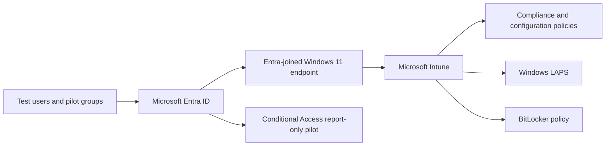

# Microsoft Entra ID & Intune Device Security Lab

A hands-on lab exploring cloud identity, Windows endpoint enrollment, configuration management, and access-policy evaluation in a test tenant. This repository documents historical lab exercises, **not** a production deployment.

## What I actually tested

A Windows 11 virtual endpoint appeared in Intune as **managed, corporate, and compliant**. Intune reported one successful BitLocker policy result, and the LAPS device page displayed a password rotation timestamp. I also examined per-setting compliance results, including an encryption-related error. Conditional Access was evaluated in **report-only** mode; Autopilot device registration was visible, but successful OOBE provisioning was not demonstrated.

## Architecture

## Recorded exercises

| Area | Recorded outcome | Important limit |
| --- | --- | --- |
| Entra ID and enrollment | Test Windows 11 device Entra-joined and enrolled in Intune | No production rollout implied |
| Device compliance | Endpoint reported compliant | Snapshot of compliance at test time |
| BitLocker | Configuration report showed 1 success, 0 errors | Policy success is not independently verified volume encryption |
| Windows LAPS | Policy and device password rotation timestamp visible | Never publish passwords or recovery secrets |
| Conditional Access | Compliant-device pilot evaluated in **report-only** mode; report-only failure visible | Policy was **not enforced** in this test |
| Autopilot | One device imported/visible; profile state observed as Pending | Complete post-wipe OOBE provisioning **not verified** |
| Defender and update management | Documented protection, update rings, and endpoint-management exercises | Supporting screenshots require individual verification |

## Evidence and verification

See the [evidence matrix](docs/evidence-matrix.md) for dated observations and the limits of each claim.

Raw screenshots may contain tenant, device, and user identifiers. **No raw screenshots are published.** Ten candidate screenshots are under private review; configuration screenshots alone do not establish successful policy application.

## Next validation

- Verify disk encryption separately from BitLocker policy success.
- Review LAPS and compliance policy/device results at full resolution.
- Keep Conditional Access explicitly **report-only** unless separately tested in enforcement mode.
- Verify Autopilot end-to-end only if claiming successful OOBE deployment.

## Technical walkthroughs

- [Windows enrollment and device management](docs/device-management.md)
- [BitLocker, Windows LAPS, Conditional Access, and Defender](docs/security-controls.md)
- [Autopilot registration and OOBE verification boundary](docs/autopilot.md)

