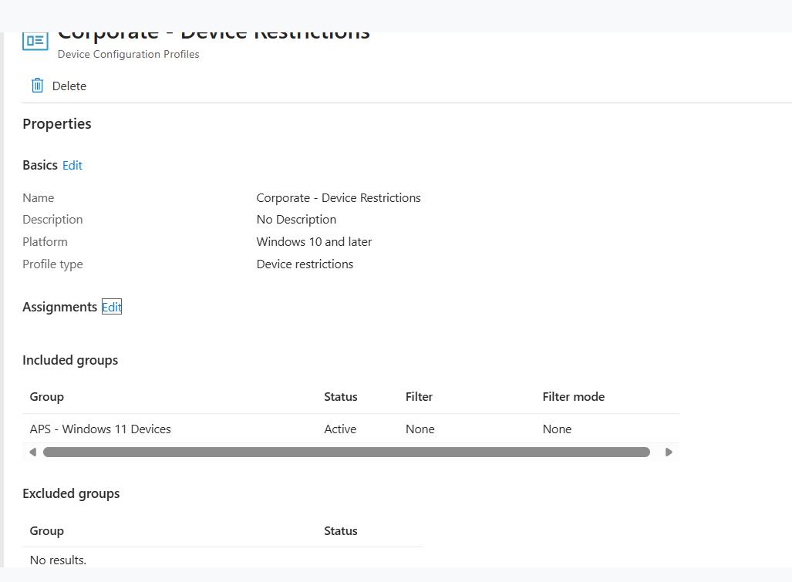
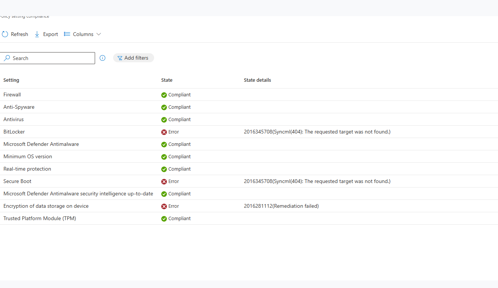
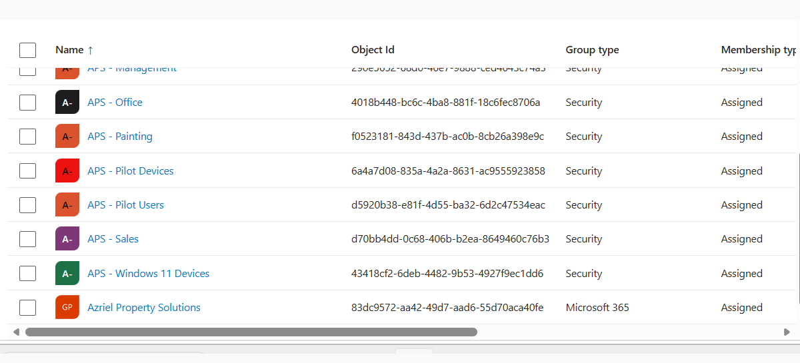
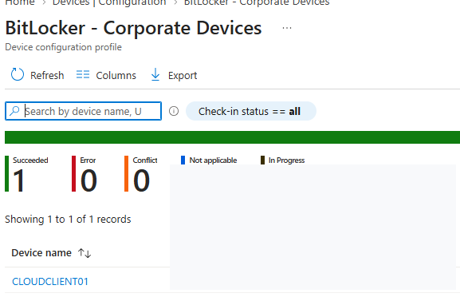
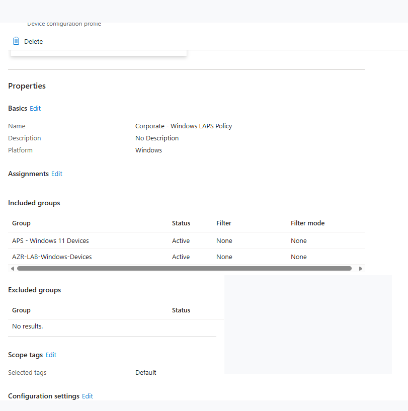
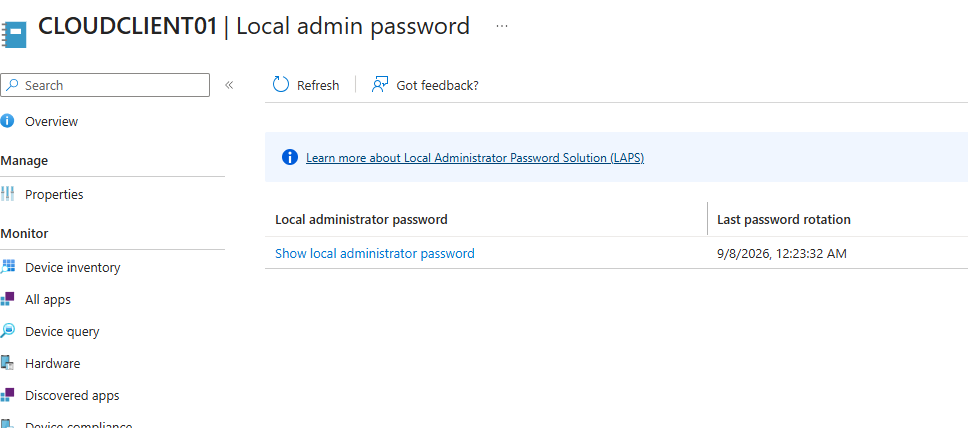
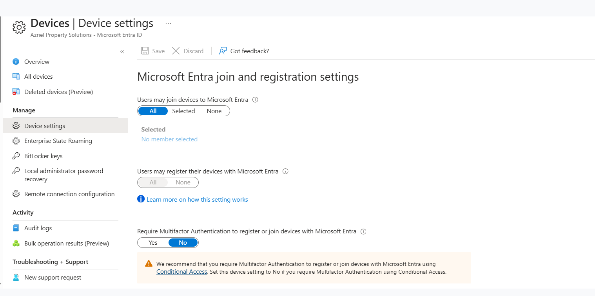
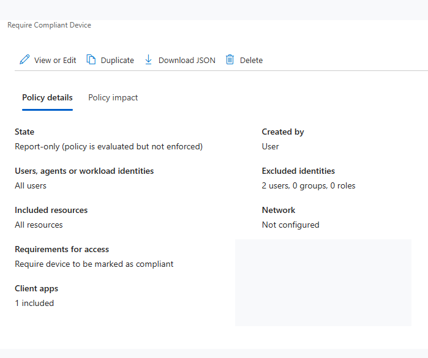
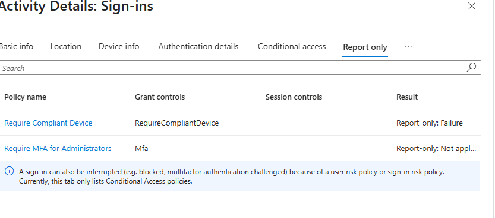
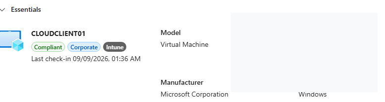

# Microsoft Entra Intune Lab — Published Screenshot Gallery

These images were uploaded by the lab owner. Captions describe the observed evidence without implying production readiness or completed validation that the images do not establish. **Publication does not mean a new independent full-resolution privacy audit has been completed.** If any image contains a sensitive identifier, remove it from GitHub and its history as appropriate.

## 1. Device restrictions profile

Policy configuration; successful application must be checked separately.

## 2. Device compliance settings

Compliance statuses including an encryption-related error.

## 3. Assigned applications

App assignments/listing, not proof of installation.

## 4. BitLocker policy deployment

A succeeded policy result; not independently proof of disk encryption.

## 5. Windows LAPS policy

LAPS configuration; do not disclose password or recovery material.

## 6. LAPS rotation status

Rotation timestamp shown, not password contents.

## 7. Windows Update ring

Update configuration, not completed patch installation.

## 8. Conditional Access policy

Report-only evaluation, not enforced access blocking.

## 9. Conditional Access report-only result

Report-only failure, not an actual blocked sign-in.

## 10. Managed compliant device

Intune-managed and compliant status at capture time.

## Evidence boundaries

Screenshots of configurations, inventories, report-only evaluations, pending states, or command attempts must not be described as end-to-end successful deployments. Original unredacted archives are not intended for public release.
